# ShopSphere

A small e-commerce web application built with **Java 25 + Spring Boot** on the
backend and **React** on the frontend, with a real **MySQL** database.

It is deliberately small and plain: two roles (customer and admin), a product
catalogue, a cart that lives in the database, a checkout that creates an order,
and order history. Every button in the UI calls a real API. There is no fake
data in the frontend.

> **Demo logins (demo data only - never use these anywhere real)**
>
> | Role | Email | Password |
> |------|-------|----------|
> | Admin | `admin@shopsphere.test` | `Admin@12345` |
> | Customer | `customer@shopsphere.test` | `Customer@12345` |
>
> These rows come from `database/data.sql`, which anybody can read on GitHub.
> That is exactly why they are demo accounts and nothing more.

**Want to learn this stack, deploy the app for free, or write it on a resume?**
Read **[`docs/LEARNING_AND_DEPLOYMENT_GUIDE.md`](docs/LEARNING_AND_DEPLOYMENT_GUIDE.md)** -
it covers what to learn in each technology, free hosting for the frontend, backend and
database, and exactly what to claim on a resume (and what not to).

---

## Table of contents

1. [What ShopSphere is](#1-what-shopsphere-is)
2. [The technologies, explained simply](#2-the-technologies-explained-simply)
3. [Architecture diagrams](#3-architecture-diagrams)
4. [Folder structure](#4-folder-structure)
5. [Backend walkthrough](#5-backend-walkthrough)
6. [Frontend walkthrough](#6-frontend-walkthrough)
7. [Database explained](#7-database-explained)
8. [Authentication and security](#8-authentication-and-security)
9. [Cart and checkout step by step](#9-cart-and-checkout-step-by-step)
10. [The hardest parts and how they were solved](#10-the-hardest-parts-and-how-they-were-solved)
11. [Troubleshooting](#11-troubleshooting)
12. [Setup: Windows and Linux/macOS](#12-setup-windows-and-linuxmacos)
13. [API documentation](#13-api-documentation)
14. [Testing](#14-testing)
15. [GitHub readiness](#15-github-readiness)
16. [Deploying it for free](#16-deploying-it-for-free)
17. [Honest limitations](#17-honest-limitations)

---

## 1. What ShopSphere is

ShopSphere is an online store with two kinds of users.

**A customer** can:

- register, log in, log out, and see who they are (`GET /api/auth/me`)
- browse the product list, search by name, and filter by category
- open a product details page
- add products to a cart that is stored in MySQL, change quantities, remove items
- place an order (checkout)
- see their order history and the details and status of each order

**An admin** can:

- add a product
- edit a product, including its stock
- deactivate a product (soft delete - the row stays in the database)
- see every order of every customer, with the items
- change an order status between `PLACED`, `SHIPPED`, `DELIVERED` and `CANCELLED`

Categories are fixed. They are loaded from `database/data.sql`; there is no
category management screen, on purpose.

### What the real screens look like

These screenshots were taken from the running application, not designed by hand.

| Home | Products |
|---|---|
| 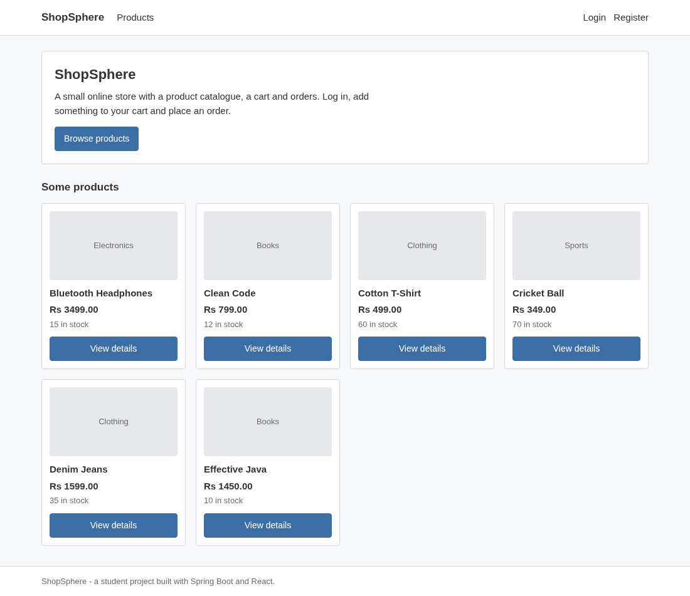 | 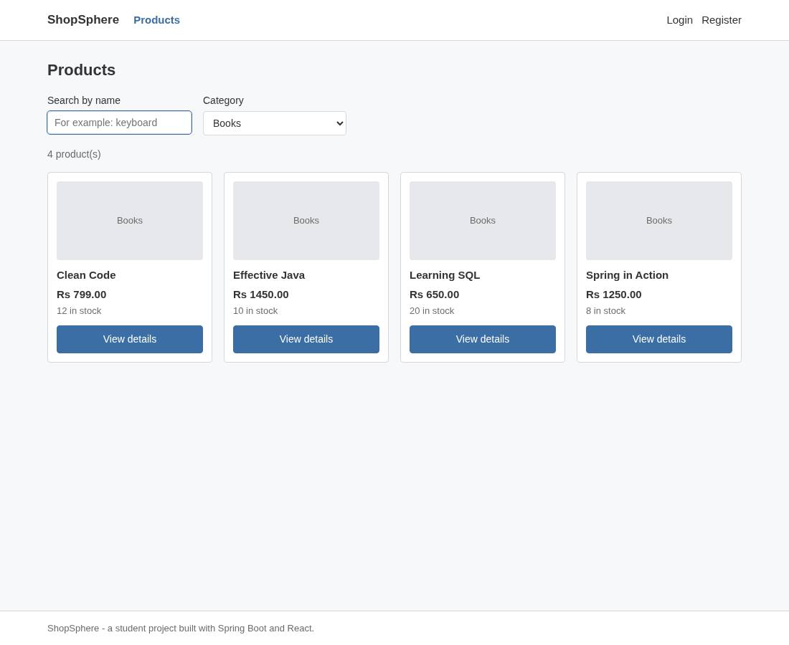 |

| Cart | Admin products |
|---|---|
| 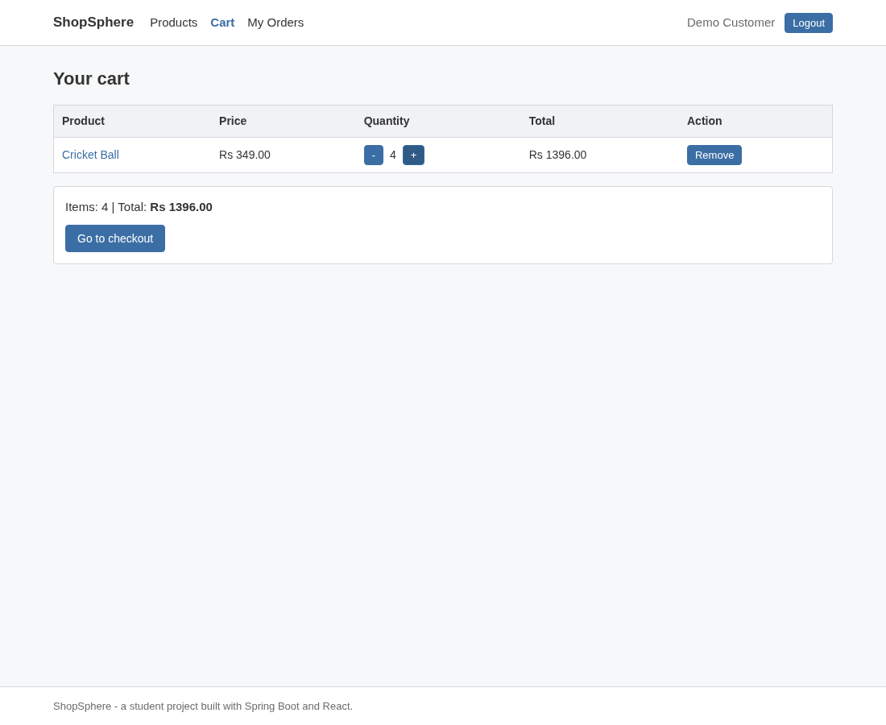 | 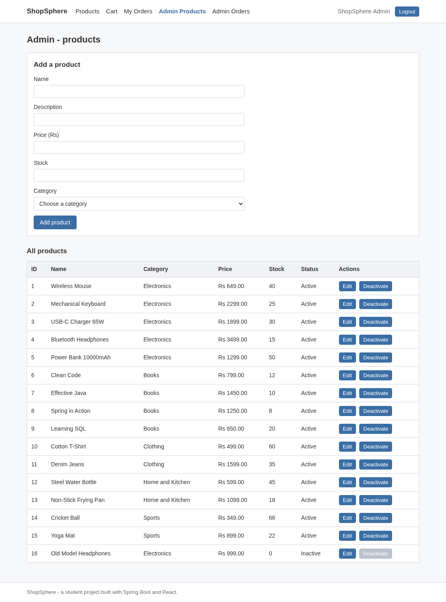 |

---

## 2. The technologies, explained simply

Each technology below answers four questions: *what is it*, *why is it here*,
*where is it used in ShopSphere*, and *what would happen without it*.

### Java 25 (LTS)

- **What:** the programming language and runtime that both the Spring Boot app
  and the Maven build run on. 25 is a Long Term Support release.
- **Why:** it is the version this project targets, it is modern (records,
  pattern matching, text blocks all used in the code) and it is supported by
  Spring Boot 4.
- **Where:** everywhere in `backend/src/main/java`.
- **Without it:** nothing on the backend would run at all.

### Spring Boot 4.2.0

- **What:** a framework that starts an embedded web server (Tomcat) and wires
  your classes together automatically.
- **Why:** it removes about 90% of the setup - you write classes with
  annotations and it starts a working HTTP API in seconds.
- **Where:** the `@SpringBootApplication` class `ShopSphereApplication`, the
  `@RestController` classes, `application.yml`.
- **Without it:** you would configure a server, a dispatcher servlet, JSON
  conversion and dependency wiring by hand.

### Spring Web (Spring MVC)

- **What:** the part of Spring that maps URLs to Java methods.
- **Why:** it is how `GET /api/products` reaches `ProductController.list(...)`.
- **Where:** every class in `controller/`.
- **Without it:** you would read the raw HTTP request yourself.

### Spring Data JPA

- **What:** a library that turns a Java interface like `ProductRepository` into
  a working database-access object at startup.
- **Why:** it removes almost all boilerplate SQL for normal reads and writes.
- **Where:** `repository/`. For example `productRepository.findByIdAndActiveTrue(id)`
  is a method nobody wrote - Spring Data builds it from the name.
- **Without it:** you would write JDBC code and manage `ResultSet`s by hand.

### Hibernate

- **What:** the actual ORM (object-relational mapper) under Spring Data JPA. It
  translates Java objects into SQL.
- **Why:** you work with `Product` objects, Hibernate writes `INSERT`/`UPDATE`.
- **Where:** indirectly everywhere; visible in the `@Entity` classes and in the
  JPQL query in `ProductRepository`.
- **Without it:** JPA would have no implementation.

### Spring Security

- **What:** the filter chain that decides whether a request may continue.
- **Why:** it protects the admin URLs, the cart and the orders.
- **Where:** `config/SecurityConfig.java`, `security/`.
- **Without it:** anybody could call `DELETE /api/admin/products/1`.

### BCrypt (via `BCryptPasswordEncoder`)

- **What:** a one-way password hashing function that is intentionally slow.
- **Why:** a stolen database must not reveal real passwords.
- **Where:** `AuthService.register` (hash), `AuthService.login` (match).
- **Without it:** passwords would be stored in plain text and one database leak
  would expose every user's password.

### JWT (JSON Web Token, library `jjwt` 0.13.0)

- **What:** a signed string that proves "this request comes from user X".
- **Why:** the API is stateless - no server session - so the token has to carry
  the identity on every request.
- **Where:** `security/JwtService` (create + validate),
  `security/JwtAuthenticationFilter` (read on every request).
- **Without it:** the server would have to keep a session in memory, which makes
  restarting and scaling harder.

### MySQL 8

- **What:** the relational database that stores users, products, carts, orders.
- **Why:** the data has clear relationships (an order has items, a product has a
  category) and needs real constraints (unique email, foreign keys, checks).
- **Where:** `database/schema.sql`, `database/data.sql`, and the JDBC URL in
  `application.yml`.
- **Without it:** data would live in memory and vanish on restart.

### Maven

- **What:** the build tool. It downloads dependencies, compiles, runs tests and
  packages a runnable jar.
- **Why:** one command (`mvn clean package`) does everything.
- **Where:** `backend/pom.xml`.
- **Without it:** you would download jar files by hand.

### React 18

- **What:** a JavaScript library for building the UI out of components.
- **Why:** pages update without a full reload, and components keep the code
  small and readable.
- **Where:** `frontend/src`.
- **Without it:** you would manipulate the DOM manually, which gets messy fast.

### React Router 6

- **What:** client-side routing - it shows a component for a URL without asking
  the server for a new page.
- **Why:** `/products/7` must show the product details page.
- **Where:** `App.jsx` (the routing table), `ProtectedRoute.jsx`.
- **Without it:** every page would be a full page reload and protected pages
  would be hard to guard.

### Fetch API

- **What:** the browser's built-in way to make HTTP requests.
- **Why:** no extra library is needed for an app this size.
- **Where:** `frontend/src/api/client.js` - one function, `request()`, used by
  every API call.
- **Without it:** you would need a third-party library (axios) for no real gain.

### HTML and CSS

- **What:** the structure and the styling of the pages.
- **Why:** one plain stylesheet (`frontend/src/styles/index.css`) is enough and
  is easy for a beginner to read.
- **Where:** JSX markup plus that one CSS file. CSS variables hold the colours.
- **Without it:** the app would be unstyled text.

### JUnit 5 (Jupiter 6.1.3)

- **What:** the testing framework that runs `@Test` methods and reports pass/fail.
- **Why:** it proves the important business rules still work after a change.
- **Where:** `backend/src/test/java/com/shopsphere/service/`.
- **Without it:** you would test by clicking, and you would forget.

### Mockito 5.24

- **What:** a library that creates fake ("mock") objects so a service can be
  tested without a database.
- **Why:** `OrderServiceTest` needs to control stock exactly and must not need
  MySQL.
- **Where:** `OrderServiceTest`, `AuthServiceTest`.
- **Without it:** the tests would need a real database and would be slower and
  harder to set up.

### Versions used, and why

| Thing | Version | Why this version |
|---|---|---|
| Java | 25 (Temurin 25.0.5.1) | The target LTS release. Spring Boot 4.2.0 supports Java 17-27, so 25 is inside the supported range. |
| Spring Boot | 4.2.0 | The current stable release (November 2026). Spring Boot 3.5 reached end of open-source support in June 2026, so 3.5 was **not** chosen. 4.2.0 brings Spring Framework 7.1.0, Spring Security 7.2.0, Hibernate 7.4.15 and Jackson 3. |
| jjwt | 0.13.0 | Current stable JWT library by a well-known maintainer. `jjwt-api` is compile scope, `jjwt-impl` and `jjwt-jackson` are runtime scope. |
| MySQL | 8.4.6 | MySQL 8 family, as required. The schema uses only standard MySQL 8 features. |
| React | 18.3.1 | Stable release; plain JavaScript, hooks and Context, no TypeScript. |
| React Router | 6.26 | The current v6 line; `BrowserRouter` + `Routes`. |
| Vite | 5.4 | Dev server and production build. |
| JUnit / Mockito | 6.1.3 / 5.24.0 | Supplied by `spring-boot-starter-test` 4.2.0. No version was pinned by hand. |

---

## 3. Architecture diagrams

### 3.1 Overall architecture

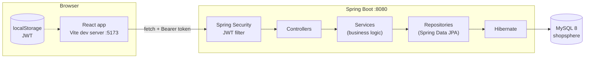

**In plain words:** the browser holds the React app and a token. Every request
carries the token, Security checks it, a controller receives the request, the
service does the real work, a repository loads or saves data, Hibernate writes
SQL, and MySQL stores the rows. The answer travels back the same way.

### 3.2 Frontend / backend communication

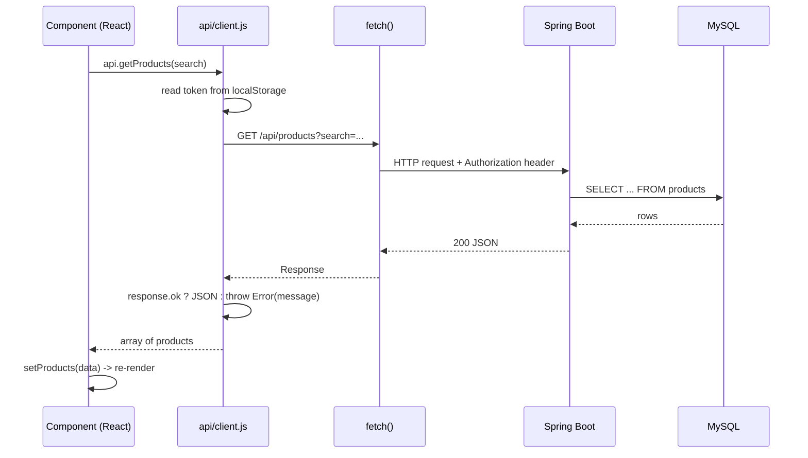

Only one file (`src/api/client.js`) knows the backend URL, attaches the token,
parses JSON and converts error responses into JavaScript `Error` objects.

### 3.3 Controller - Service - Repository

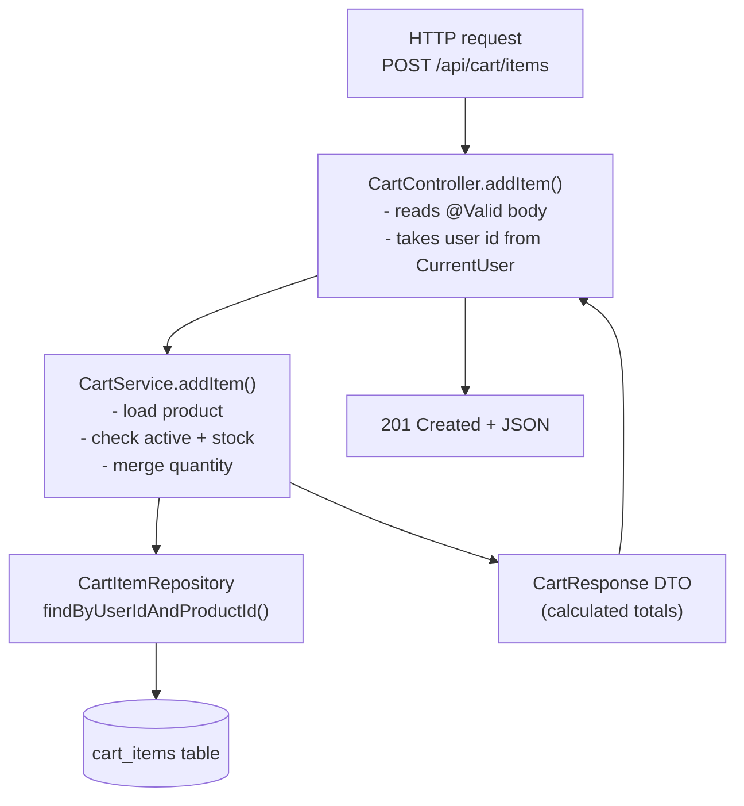

**Rules this project follows:** controllers only translate HTTP, services hold
every business rule, repositories only talk to the database, DTOs travel to the
browser, entities never leave the backend.

### 3.4 Login and JWT

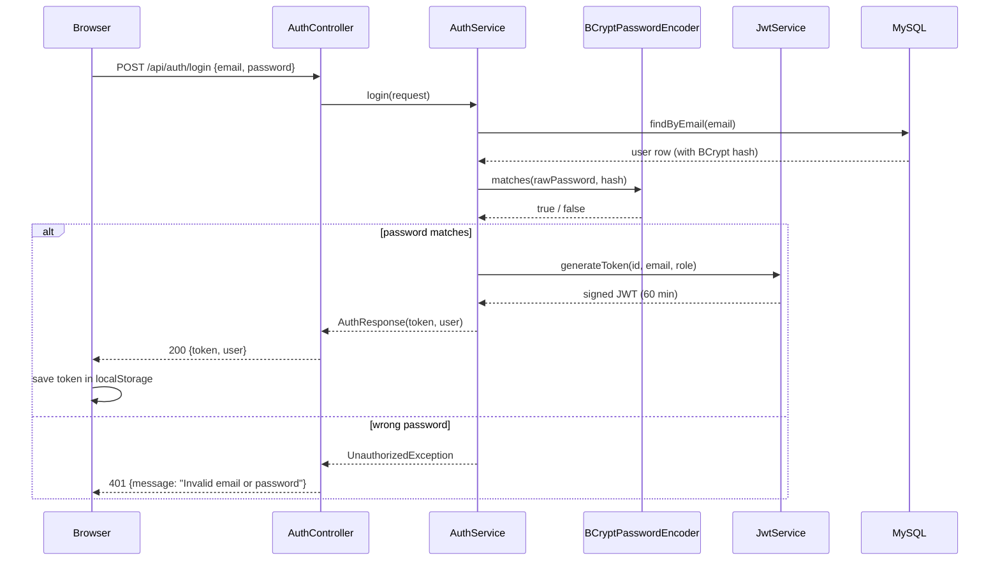

### 3.5 The JWT filter on every later request

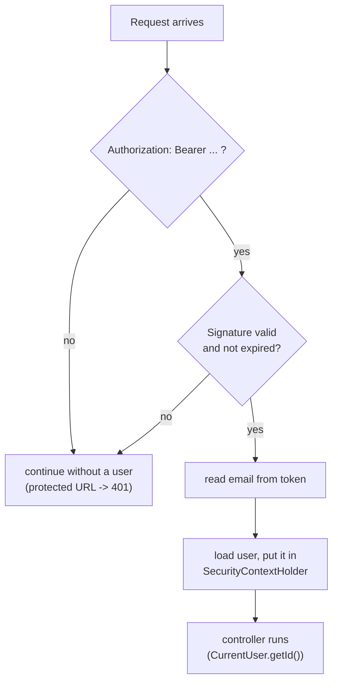

### 3.6 Checkout

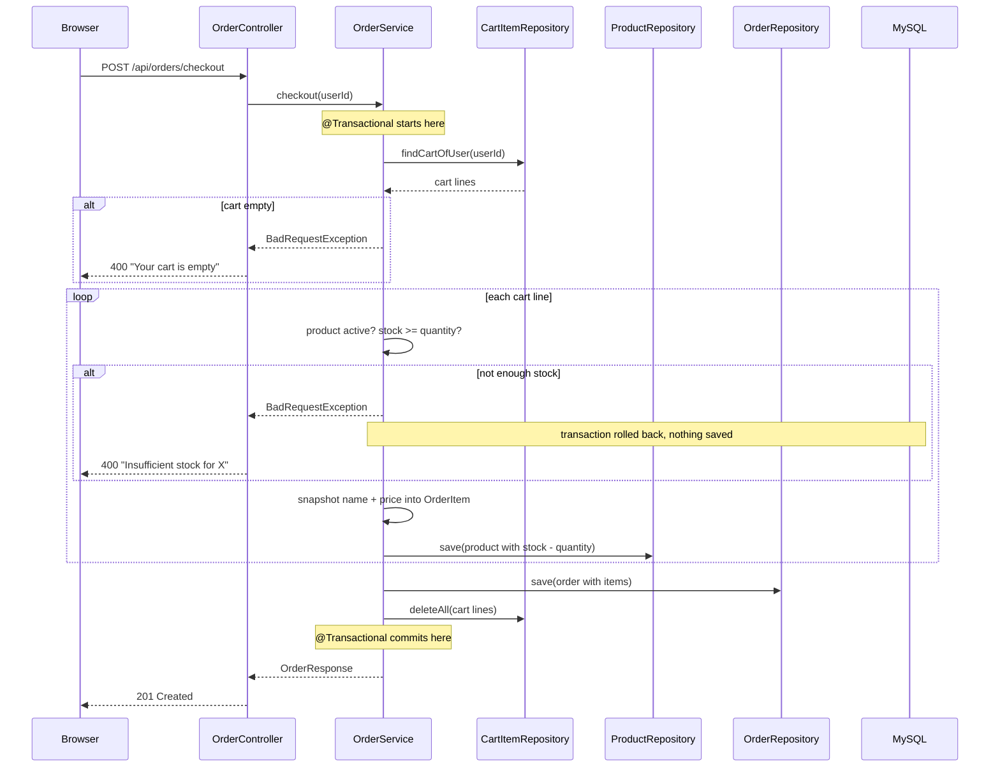

### 3.7 Database ER diagram

```mermaid
erDiagram
    USERS ||--o{ CART_ITEMS : "has"
    USERS ||--o{ ORDERS : "places"
    CATEGORIES ||--o{ PRODUCTS : "contains"
    PRODUCTS ||--o{ CART_ITEMS : "appears in"
    PRODUCTS ||--o{ ORDER_ITEMS : "referenced by"
    ORDERS ||--|{ ORDER_ITEMS : "contains"

    USERS {
        bigint id PK
        varchar name
        varchar email UK
        varchar password_hash
        varchar role "CUSTOMER or ADMIN"
        timestamp created_at
        timestamp updated_at
    }
    CATEGORIES {
        bigint id PK
        varchar name UK
    }
    PRODUCTS {
        bigint id PK
        varchar name
        varchar description
        decimal price "10,2"
        int stock "CHECK >= 0"
        boolean active "soft delete"
        bigint category_id FK
    }
    CART_ITEMS {
        bigint id PK
        bigint user_id FK
        bigint product_id FK
        int quantity "CHECK >= 1"
        unique "user_id + product_id"
    }
    ORDERS {
        bigint id PK
        bigint user_id FK
        varchar status
        decimal total_amount "10,2"
        timestamp created_at
    }
    ORDER_ITEMS {
        bigint id PK
        bigint order_id FK
        bigint product_id FK
        varchar product_name "copy at purchase"
        decimal unit_price "copy at purchase"
        int quantity
    }
```

**Reading the diagram:** one row on the left can be linked to many rows on the
right (`||--o{` means "exactly one to zero or many"). A user has many cart items
and many orders; an order has at least one order item; a category has many
products.

---

## 4. Folder structure

```
shopsphere/
├── README.md                       this file
├── .env.example                    placeholder environment variables (backend)
├── .gitignore                      what must never be committed
├── database/
│   ├── schema.sql                  creates the 6 tables, keys, indexes, checks
│   └── data.sql                    demo data: 1 admin, 1 customer, 5 categories, 16 products
├── docs/
│   ├── CHECKLIST.md                build checklist, ticked only after verification
│   ├── PROJECT_FLOW.md             every step from opening the site to checkout
│   ├── INTERVIEW_PREPARATION.md    spoken explanation, Q&A, scenarios, resume bullets
│   ├── DEVELOPMENT_LOG.md          real history: decisions, bugs, fixes, results
│   ├── LEARNING_AND_DEPLOYMENT_GUIDE.md  what to learn per stack, free deploy, resume text
│   └── screenshots/                real screenshots of the running app
├── backend/
│   ├── pom.xml                     Maven build: dependencies and plugins
│   ├── Dockerfile                  multi-stage image used by free hosts (Render/Railway)
│   ├── .dockerignore               keeps target/ and .env out of the image
│   └── src/
│       ├── main/java/com/shopsphere/
│       │   ├── ShopSphereApplication.java   entry point (@SpringBootApplication)
│       │   ├── config/             SecurityConfig: filter chain, CORS, BCrypt bean
│       │   ├── controller/         7 controllers, 19 endpoints - HTTP only
│       │   ├── dto/                16 records - the JSON contract with the frontend
│       │   ├── entity/             6 entities + Role + OrderStatus enums
│       │   ├── repository/         5 Spring Data interfaces (no implementations)
│       │   ├── service/            5 services - all business logic
│       │   ├── security/           JWT service, JWT filter, UserDetails, CurrentUser
│       │   └── exception/          ApiException family + GlobalExceptionHandler
│       ├── main/resources/
│       │   ├── application.yml     configuration, everything from env variables
│       │   └── application-prod.yml   host-injected PORT + JWT_SECRET enforcement
│       └── test/java/com/shopsphere/service/
│           ├── AuthServiceTest.java     2 tests (BCrypt hash, duplicate email)
│           └── OrderServiceTest.java    4 tests (checkout, stock, ownership, empty cart)
└── frontend/
    ├── package.json                scripts and dependencies
    ├── vite.config.js              dev server, /api proxy, allowedHosts
    ├── vercel.json                 build settings + SPA rewrite for Vercel
    ├── public/_redirects           SPA rewrite for Netlify / Cloudflare Pages
    ├── .env.example                VITE_API_BASE_URL placeholder
    ├── index.html                  the single HTML page
    └── src/
        ├── main.jsx                mounts React, Router and AuthProvider
        ├── App.jsx                 only the routing table
        ├── api/client.js           every fetch call + token handling
        ├── context/AuthContext.jsx the only Context: who is logged in
        ├── components/             Navbar, Footer, ProductCard, FormField, Loading,
        │                           ErrorMessage, EmptyState, ProtectedRoute
        ├── pages/                  12 page components
        └── styles/index.css        all styling, one plain CSS file
```

### Why these folders exist

| Folder | Why it exists | What would go wrong without it |
|---|---|---|
| `entity` | One class per table, mapped with JPA annotations. | SQL strings scattered everywhere; no compile-time safety. |
| `dto` | The shapes that go in and out of the API. | Sending an entity would leak `password_hash` and couple the JSON to the table layout. |
| `repository` | One interface per entity for database access. | Every service would contain JDBC code and duplicate queries. |
| `service` | Business rules: hashing, stock checks, ownership, checkout. | Controllers become 200-line monsters that cannot be unit tested. |
| `controller` | URL mapping, validation, HTTP status codes. | Routing logic mixed with business logic. |
| `config` | Wiring that is not business logic: security rules, CORS, beans. | Security rules spread across classes. |
| `security` | JWT creation, validation, the filter, `CurrentUser`. | Every controller would parse tokens itself. |
| `exception` | One error format for the whole API. | Each endpoint returns a different error shape; the frontend cannot show messages. |

---

## 5. Backend walkthrough

All backend classes live under `com.shopsphere`.

### 5.1 `ShopSphereApplication`

- **Package:** `com.shopsphere`
- **Responsibility:** start the app.
- **Key annotation:** `@SpringBootApplication` = `@Configuration` +
  `@EnableAutoConfiguration` + `@ComponentScan`.
- **What it does:** `SpringApplication.run(...)` starts Tomcat, scans
  `com.shopsphere.**` for components, reads `application.yml`, opens the MySQL
  connection pool.

```java
@SpringBootApplication
public class ShopSphereApplication {
    public static void main(String[] args) {
        SpringApplication.run(ShopSphereApplication.class, args);
    }
}
```

### 5.2 `entity/Product`

- **Responsibility:** represent one row of `products`.
- **Annotations:** `@Entity`, `@Table(name = "products")`, `@Id`,
  `@GeneratedValue(strategy = IDENTITY)`, `@ManyToOne(fetch = LAZY)`,
  `@JoinColumn(name = "category_id")`.
- **Key fields:** `id`, `name`, `price` (`BigDecimal`), `stock` (`int`),
  `active` (`boolean`), `category`.
- **Why `BigDecimal`:** money must be exact. `double` cannot represent `0.10`
  exactly, and rounding errors add up in a cart total.

```java
@ManyToOne(fetch = FetchType.LAZY, optional = false)
@JoinColumn(name = "category_id", nullable = false)
private Category category;

@Column(name = "price", nullable = false, precision = 10, scale = 2)
private BigDecimal price;
```

The constructor is `protected` and there is no setter for `id`: JPA needs the
empty constructor, and only the database assigns ids.

### 5.3 `entity/Order` and `entity/OrderItem`

`Order` is the header; `OrderItem` is a line. The relationship is
`@OneToMany(mappedBy = "order", cascade = ALL, orphanRemoval = true)`.

```java
public void addItem(OrderItem item) {
    items.add(item);
    item.setOrder(this);
    recalculateTotal();
}

private void recalculateTotal() {
    BigDecimal total = BigDecimal.ZERO;
    for (OrderItem item : items) {
        total = total.add(item.getLineTotal());
    }
    this.totalAmount = total;
}
```

`addItem` keeps both sides of the relationship in sync **and** recomputes the
total, so the stored total can never disagree with the lines.

`OrderItem` stores `productName` and `unitPrice` as *its own columns*. That is
the "purchase-time price" idea: see [section 9](#9-cart-and-checkout-step-by-step).

### 5.4 `repository/ProductRepository`

Spring Data writes the implementation, so this file only declares methods.

```java
@Query("""
        SELECT p FROM Product p
        WHERE p.active = true
          AND (:search IS NULL OR LOWER(p.name) LIKE LOWER(CONCAT('%', :search, '%')))
          AND (:categoryId IS NULL OR p.category.id = :categoryId)
        ORDER BY p.name ASC
        """)
List<Product> searchActiveProducts(@Param("search") String search,
                                   @Param("categoryId") Long categoryId);
```

- One query handles four cases: no filter, search only, category only, both.
- `:search IS NULL OR ...` means "ignore this filter when the value is null".
- It is JPQL: `Product` and `p.category.id` are Java names, not table names.

```java
Optional<Product> findByIdAndActiveTrue(Long id);   // used by product details + cart
List<Product> findAllByOrderByIdAsc();              // admin list, includes inactive
```

`CartItemRepository` has the ownership-safe lookup:

```java
Optional<CartItem> findByIdAndUserId(Long id, Long userId);
```

### 5.5 `service/AuthService`

- **Responsibility:** register, login, convert a `User` to a `UserResponse`.
- **Dependencies:** `UserRepository`, `BCryptPasswordEncoder`, `JwtService`.

`register`:

1. lower-cases the email,
2. `existsByEmail` -> `ConflictException` (409) if taken,
3. `passwordEncoder.encode(password)` -> BCrypt hash,
4. builds `new User(name, email, hash, Role.CUSTOMER)` - **the role is hard-coded**,
5. saves and returns a `UserResponse` (which has no password field at all).

`login`:

1. `findByEmail`,
2. if missing -> `UnauthorizedException` with the *same* message as a wrong
   password, so the API does not reveal which emails exist,
3. `passwordEncoder.matches(raw, hash)`,
4. `jwtService.generateToken(id, email, role.name())`.

### 5.6 `service/CartService`

| Method | What it does |
|---|---|
| `getCart(userId)` | loads the user's lines, builds `CartResponse` with server-calculated totals |
| `addItem(userId, request)` | loads an **active** product, merges with an existing line, checks stock, saves |
| `updateQuantity(userId, itemId, quantity)` | loads the line **by id and user id**, checks stock, saves |
| `removeItem(userId, itemId)` | same ownership check, then deletes |
| `checkStock(product, quantity)` | throws `BadRequestException` for `quantity < 1` or `quantity > stock` |
| `toCartResponse(items)` | maps lines and reduces them into a total |

The important line for security is inside `findOwnedItem`:

```java
return cartItemRepository.findByIdAndUserId(cartItemId, userId)
        .orElseThrow(() -> new NotFoundException("Cart item not found"));
```

A customer cannot address somebody else's cart row, because the query itself
filters on their user id.

### 5.7 `service/OrderService.checkout` - the most important method

```java
@Transactional
public OrderResponse checkout(Long userId) {
    List<CartItem> cartItems = cartItemRepository.findCartOfUser(userId);
    if (cartItems.isEmpty()) {
        throw new BadRequestException("Your cart is empty");
    }

    User user = userRepository.findById(userId)
            .orElseThrow(() -> new NotFoundException("User not found"));

    Order order = new Order(user);

    for (CartItem cartItem : cartItems) {
        Product product = cartItem.getProduct();

        if (!product.isActive()) {
            throw new BadRequestException(product.getName() + " is no longer available");
        }
        if (cartItem.getQuantity() > product.getStock()) {
            throw new BadRequestException("Insufficient stock for " + product.getName());
        }

        BigDecimal unitPrice = product.getPrice();
        order.addItem(new OrderItem(product, product.getName(), unitPrice, cartItem.getQuantity()));

        product.setStock(product.getStock() - cartItem.getQuantity());
        productRepository.save(product);
    }

    Order saved = orderRepository.save(order);
    cartItemRepository.deleteAll(cartItems);

    return toResponse(saved, true);
}
```

Read it as a checklist: cart not empty -> user exists -> every product still
active -> enough stock -> copy name and price -> reduce stock -> save order ->
clear cart. Any failure throws, and the whole transaction rolls back.

### 5.8 `controller/CartController`

```java
@PostMapping("/items")
public ResponseEntity<CartResponse> addItem(@Valid @RequestBody AddCartItemRequest request) {
    CartResponse cart = cartService.addItem(currentUser.getId(), request);
    return ResponseEntity.status(HttpStatus.CREATED).body(cart);
}
```

Three things to notice: `@Valid` runs Bean Validation before the method body,
`currentUser.getId()` comes from the JWT (never from the request body), and the
status is explicit (`201`).

### 5.9 `security/JwtService`

```java
public String generateToken(Long userId, String email, String role) {
    Instant now = Instant.now();
    return Jwts.builder()
            .subject(email)
            .claim("userId", userId)
            .claim("role", role)
            .issuedAt(Date.from(now))
            .expiration(Date.from(now.plus(expiration)))
            .signWith(secretKey)
            .compact();
}
```

- `subject` = email, plus two custom claims.
- `expiration` = now + 60 minutes (`JWT_EXPIRATION_MINUTES`).
- `signWith(secretKey)` uses HS512 with the `JWT_SECRET` from the environment.
- The constructor throws at startup if the secret is missing or shorter than 32
  bytes - better a clear crash than silently weak signing.

`parse()` catches `JwtException` and returns `null`, so an expired or tampered
token is simply "not valid" instead of a 500 error.

### 5.10 `security/JwtAuthenticationFilter`

Extends `OncePerRequestFilter`, so it runs exactly once per request. It reads
`Authorization: Bearer <token>`, validates it, loads the user and stores an
`Authentication` in the `SecurityContextHolder`. If anything is wrong it just
continues anonymously - `SecurityConfig` then produces 401 or 403.

### 5.11 `security/CurrentUser`

```java
public Long getId() {
    return get().getId();
}
```

The single answer to "who is calling?". The user id always comes from the
security context, which came from a signed token.

### 5.12 `config/SecurityConfig`

```java
.authorizeHttpRequests(auth -> auth
        .requestMatchers("/api/auth/register", "/api/auth/login").permitAll()
        .requestMatchers(HttpMethod.GET, "/api/products", "/api/products/**", "/api/categories").permitAll()
        .requestMatchers("/api/admin/**").hasRole("ADMIN")
        .anyRequest().authenticated())
```

- `.csrf(disable)` and `SessionCreationPolicy.STATELESS`: there are no cookies
  or sessions, so there is nothing for CSRF to protect.
- `hasRole("ADMIN")` really checks the authority `ROLE_ADMIN`; see
  `AppUserDetails.getAuthorities()`.
- The CORS bean allows exactly one origin: `CORS_ALLOWED_ORIGIN`.
- `passwordEncoder()` returns `BCryptPasswordEncoder` - the one bean used for
  hashing and matching everywhere.

### 5.13 `exception/GlobalExceptionHandler`

```java
@ExceptionHandler(ApiException.class)
public ResponseEntity<ApiError> handleApiException(ApiException ex) {
    HttpStatus status = ex.getStatus();
    return ResponseEntity.status(status)
            .body(new ApiError(status.value(), status.getReasonPhrase(), ex.getMessage()));
}
```

| Exception | Status | Example |
|---|---|---|
| `NotFoundException` | 404 | product or order not found (or not yours) |
| `BadRequestException` | 400 | empty cart, insufficient stock, final order edited |
| `ConflictException` | 409 | email already registered |
| `UnauthorizedException` | 401 | wrong email or password at login |
| `MethodArgumentNotValidException` | 400 + `fieldErrors` | `@NotBlank` failed |
| `HttpMessageNotReadableException` | 400 | malformed JSON, unknown enum value |
| `AccessDeniedException` | 403 | wrong role |
| anything else | 500 | logged, generic message to the client |

---

## 6. Frontend walkthrough

### 6.1 Component structure

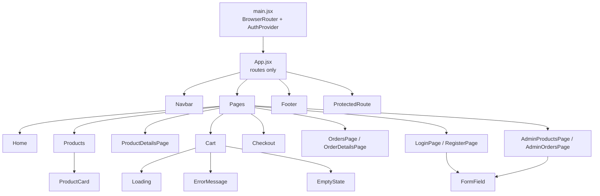

`Navbar` is outside the routes so it never re-mounts while navigating. `App.jsx`
stays at about 90 lines: it is only a routing table.

### 6.2 Routing

| URL | Page | Protected? |
|---|---|---|
| `/` | HomePage | no |
| `/login`, `/register` | Login / Register | no |
| `/products` | ProductsPage | no |
| `/products/:id` | ProductDetailsPage | no |
| `/cart` | CartPage | login |
| `/checkout` | CheckoutPage | login |
| `/orders` | OrdersPage | login |
| `/orders/:id` | OrderDetailsPage | login |
| `/admin/products` | AdminProductsPage | login + ADMIN |
| `/admin/orders` | AdminOrdersPage | login + ADMIN |
| `*` | NotFoundPage | no |

### 6.3 `useState` and `useEffect`

Every data page follows the same small pattern:

```jsx
const [products, setProducts] = useState([])
const [loading, setLoading] = useState(true)
const [error, setError] = useState('')

useEffect(() => {
  let cancelled = false
  async function load() {
    try {
      const data = await api.getProducts(search.trim(), categoryId)
      if (!cancelled) setProducts(data)
    } catch (err) {
      if (!cancelled) setError(err.message)
    } finally {
      if (!cancelled) setLoading(false)
    }
  }
  load()
  return () => { cancelled = true }
}, [search, categoryId])
```

- `loading` shows `<Loading />`, `error` shows `<ErrorMessage />`.
- The `cancelled` flag stops an old response from overwriting a newer one when
  the search changes quickly.
- `[search, categoryId]` is the dependency array: change either value and the
  effect runs again - that is the whole search feature.

### 6.4 Context

Only one Context exists, `AuthContext`. It stores `user`, exposes
`isLoggedIn`, `isAdmin`, `login`, `register`, `logout`, and on a page reload it
calls `GET /api/auth/me` with the stored token to restore the user.

```jsx
async function login(email, password) {
  const result = await api.login({ email, password })
  saveToken(result.token)
  setUser(result.user)
  return result.user
}
```

### 6.5 Forms

`FormField` renders a label, an input and an error message.
`LoginPage` and `RegisterPage` validate in the browser *before* calling the API
(required fields, email shape, password length) and also show whatever errors
the server returns. The server validates again - client validation is
convenience, not security.

### 6.6 Protected routes

```jsx
<Route path="/admin/products" element={
  <ProtectedRoute adminOnly><AdminProductsPage /></ProtectedRoute>
} />
```

`ProtectedRoute` shows a loading state while the token is being checked,
redirects to `/login` when nobody is logged in (remembering where the user came
from), and shows a plain message when a customer opens an admin page. The
backend blocks the API regardless.

### 6.7 The API folder

`src/api/client.js` exports one `api` object. Inside, `request()`:

1. builds headers (adds `Content-Type: application/json` when there is a body),
2. adds `Authorization: Bearer <token>` when a token exists,
3. calls `fetch`,
4. turns a network failure into *"Cannot reach the server. Is the backend running?"*,
5. turns `!response.ok` into an `Error` whose message is the server's message
   (or the joined `fieldErrors`).

Because of this, pages only ever write `try { ... } catch (err) { setError(err.message) }`.

### 6.8 From clicking "Add to cart" to the updated UI

Follow the product details page:

| Step | Where | What happens |
|---|---|---|
| 1 | `ProductDetailsPage` | The user sets quantity and clicks the button. `handleAddToCart()` runs. |
| 2 | `src/api/client.js` | `api.addToCart(product.id, Number(quantity))` builds `POST /api/cart/items` with `{ productId, quantity }` and the Bearer token. |
| 3 | Spring Security | `JwtAuthenticationFilter` validates the token and puts the user in the `SecurityContext`. |
| 4 | `CartController.addItem` | `@Valid` checks `@NotNull` and `@Min(1)`; `currentUser.getId()` reads the user from the context. |
| 5 | `CartService.addItem` | Loads the active product, merges with an existing cart row, `checkStock`, saves. |
| 6 | `CartItemRepository` | `findByUserIdAndProductId` + `save` -> Hibernate writes `INSERT`/`UPDATE cart_items`. |
| 7 | MySQL | The row is stored (unique on `user_id + product_id`). |
| 8 | back up the chain | `CartResponse` with recalculated totals, `201 Created`. |
| 9 | `src/api/client.js` | Sees `response.ok`, parses JSON, returns it. |
| 10 | `ProductDetailsPage` | `setSuccess('Added to cart.')`, so a green box appears. The navbar Cart link is already there; opening the cart calls `GET /api/cart`, and the item is there because it was written to MySQL, not to the browser. |

---

## 7. Database explained

### 7.1 Tables

**users**

| Column | Type | Notes |
|---|---|---|
| `id` | BIGINT PK AI | |
| `name` | VARCHAR(100) | |
| `email` | VARCHAR(150) | UNIQUE - a login name must be unique |
| `password_hash` | VARCHAR(100) | BCrypt hash (60 characters) |
| `role` | VARCHAR(20) | `CUSTOMER` or `ADMIN`, guarded by a CHECK |
| `created_at`, `updated_at` | TIMESTAMP | filled by MySQL |

**categories** - `id`, `name` (UNIQUE), timestamps. Seeded only.

**products**

| Column | Type | Notes |
|---|---|---|
| `price` | DECIMAL(10,2) | exact money, CHECK >= 0 |
| `stock` | INT | CHECK >= 0 |
| `active` | BOOLEAN | the soft-delete flag |
| `category_id` | BIGINT FK | -> `categories.id` |

Indexes: `idx_products_name`, `idx_products_category_id`, `idx_products_active`.

**cart_items** - `user_id` FK, `product_id` FK, `quantity` (CHECK >= 1), with
`UNIQUE(user_id, product_id)` so one product appears once per cart.

**orders** - `user_id` FK, `status` (CHECK in the 4 values), `total_amount`
DECIMAL(10,2). Indexes on `user_id` and `status`.

**order_items** - `order_id` FK, `product_id` FK, `product_name`, `unit_price`,
`quantity`. Indexes on `order_id` and `product_id`.

### 7.2 Relationships

| Relationship | Type | Where it is expressed |
|---|---|---|
| category -> products | one-to-many | `products.category_id` |
| user -> cart_items | one-to-many | `cart_items.user_id` |
| user -> orders | one-to-many | `orders.user_id` |
| order -> order_items | one-to-many | `order_items.order_id` |
| product -> cart_items | one-to-many | `cart_items.product_id` |
| product -> order_items | one-to-many | `order_items.product_id` |

In Java each "many" side is a `@ManyToOne`, and `Order` has the matching
`@OneToMany`.

### 7.3 Why the design is like this

**Why DECIMAL for money?** `DECIMAL(10,2)` stores exactly two decimal digits.
A `FLOAT`/`double` stores an approximation, so `0.1 + 0.2` is not `0.3`, and a
cart total can be off by a paisa. In Java the matching type is `BigDecimal`.

**Why soft delete?** `DELETE FROM products WHERE id = 5` would break every
`order_items` row that points at product 5, or (with `ON DELETE CASCADE`) would
silently erase history. Setting `active = false` keeps the row, keeps the
foreign keys valid, and simply hides the product from customers. "Delete" in
this app always means deactivate.

**Why does `order_items` store its own price?** Because a price is a fact about
a moment. If the admin raises the price of Wireless Mouse from 649 to 899 next
month, last month's order must still say 649. The order line therefore keeps a
copy (`product_name`, `unit_price`) plus the `product_id` link for reference.

**Why is the schema normalized?** The category name is stored once in
`categories`, not repeated in every product row. Renaming "Books" to "Books and
Media" is a single `UPDATE`. No fact is stored in two places, so no two places
can disagree.

**Why `UNIQUE(user_id, product_id)` in `cart_items`?** Without it, adding the
same product twice creates two rows and every total has to be de-duplicated.
With it, one row per product and adding again simply raises the quantity.

### 7.4 Sample queries

**1. Active products in Books, cheapest first**

```sql
SELECT p.id, p.name, p.price, p.stock
FROM products p
JOIN categories c ON c.id = p.category_id
WHERE p.active = TRUE AND c.name = 'Books'
ORDER BY p.price;
```

**2. Search by name (what the API does with the `search` parameter)**

```sql
SELECT id, name, price FROM products
WHERE active = TRUE AND LOWER(name) LIKE '%keyboard%';
```

**3. A customer's cart with line totals**

```sql
SELECT ci.id, p.name, ci.quantity, p.price, (ci.quantity * p.price) AS line_total
FROM cart_items ci
JOIN products p ON p.id = ci.product_id
WHERE ci.user_id = 2;
```

**4. One order with its lines (prices as they were at purchase time)**

```sql
SELECT o.id, o.status, o.total_amount, oi.product_name, oi.unit_price, oi.quantity
FROM orders o
JOIN order_items oi ON oi.order_id = o.id
WHERE o.id = 1;
```

**5. Who bought what (report style)**

```sql
SELECT u.email, o.id AS order_id, oi.product_name, oi.quantity, oi.unit_price
FROM orders o
JOIN users u ON u.id = o.user_id
JOIN order_items oi ON oi.order_id = o.id
ORDER BY o.id DESC;
```

### 7.5 How the schema is created, loaded and reset

The backend **never** creates tables. `spring.jpa.hibernate.ddl-auto` is `none`
and `spring.sql.init.mode` is `never`, so there is exactly one source of truth:
the two SQL files.

```bash
# 1. create tables (also creates the database)
mysql -u root -p < database/schema.sql

# 2. load demo data
mysql -u root -p < database/data.sql
```

`data.sql` starts with `DELETE FROM ...` for the six tables in foreign-key
order, so running it again is a clean reset: orders and carts disappear,
products go back to the seed rows, and the two demo users are restored.

Full reset including the tables themselves:

```bash
mysql -u root -p -e "DROP DATABASE shopsphere;"
mysql -u root -p < database/schema.sql
mysql -u root -p < database/data.sql
```

---

## 8. Authentication and security

### 8.1 Registration

`POST /api/auth/register` with `{name, email, password}`.

1. Bean Validation: name and email required, email must look like an email,
   password 8-72 characters.
2. The email is lower-cased and checked with `existsByEmail` -> 409 if taken.
3. The password is hashed: `new BCryptPasswordEncoder().encode("Customer@12345")`
   gives something like `$2a$10$eWzmD2ON1ep.kl7neK2Kq.UpitwiaB1eULaQV7evgXeaIubZd038S`.
4. The role is hard-coded to `CUSTOMER`. There is no field in `RegisterRequest`
   that could ask for anything else - nobody can register as an admin.
5. `201 Created` with `{id, name, email, role}`. No token is returned; the
   frontend logs in right after registering.

### 8.2 Why BCrypt

- **One-way:** you cannot compute the password from the hash.
- **Salted:** each hash contains a random salt, so two users with the same
  password get different hashes (and rainbow tables do not help).
- **Deliberately slow:** the cost factor (10) makes brute force expensive.
- **Checked, never decrypted:** login calls `matches(raw, hash)`.

A `$2a$10$...` hash is exactly 60 characters, which is why the column is
`VARCHAR(100)`.

### 8.3 Login and JWT creation

```
POST /api/auth/login  {"email":"customer@shopsphere.test","password":"Customer@12345"}
-> 200 {"token":"eyJhbGciOiJIUzUxMiJ9.eyJzdWIiOiJjdXN0b21lckBzaG9wc3BoZXJlLnRlc3QiLCJ1c2VySWQiOjIsInJvbGUiOiJDVVNUT01FUiIsImlhdCI6MTc5NTUwNzc5MiwiZXhwIjoxNzk1NTExMzkyfQ...",
        "tokenType":"Bearer","expiresInSeconds":3600,
        "user":{"id":2,"name":"Demo Customer","email":"customer@shopsphere.test","role":"CUSTOMER"}}
```

Decoded payload of that token (base64 is not encryption):

```json
{"sub":"customer@shopsphere.test","userId":2,"role":"CUSTOMER","iat":1795507792,"exp":1795511392}
```

A JWT has three parts: `header.payload.signature`. The payload is readable by
anyone; the signature proves the server created it, so nobody can turn
`"role":"CUSTOMER"` into `"role":"ADMIN"`.

### 8.4 Validation on every request

`JwtAuthenticationFilter` runs before the request reaches a controller:

1. no `Authorization` header -> continue anonymously,
2. `isTokenValid` fails (bad signature, expired, malformed) -> continue anonymously,
3. valid -> load the user from the database, put it in `SecurityContextHolder`,
4. `SecurityConfig` then allows or rejects the request based on the URL and role.

### 8.5 Roles

`AppUserDetails.getAuthorities()` returns `ROLE_ADMIN` or `ROLE_CUSTOMER`.
`hasRole("ADMIN")` adds the `ROLE_` prefix itself. The admin check lives in one
place (`SecurityConfig`), and the controllers do not repeat it.

### 8.6 Expiry and logout

- Tokens expire after 60 minutes (`JWT_EXPIRATION_MINUTES`). An expired token is
  rejected like a bad one; the frontend gets 401 and the user logs in again.
- **Logout is a frontend action.** The React app deletes the token from
  `localStorage` and clears the user state. There is no server call, and the
  token itself would still be accepted by the server until it expires. This is
  honest, simple, and normal for short-lived bearer tokens. A server-side
  revocation list or refresh tokens were deliberately left out of scope.

### 8.7 Why bearer tokens, and where to keep them

A **bearer token** means "whoever holds this string is treated as that user".
It is sent in the `Authorization: Bearer <token>` header rather than a cookie,
which suits a React app on a different port than the API.

| Storage | Good | Bad |
|---|---|---|
| `localStorage` (what ShopSphere uses) | Simple, survives a page reload, works with any `fetch` call | Readable by any JavaScript on the page, so an XSS bug would leak the token |
| `HttpOnly` cookie | JavaScript cannot read it, so XSS cannot steal it | Sent automatically on every request, which needs CSRF protection; awkward across different origins |

Neither option is "safe". The real protections are: short expiry, no XSS bugs,
HTTPS in production, and `Content-Security-Policy`. ShopSphere uses
`localStorage` because it is the simplest thing a beginner can read and debug,
and this README says plainly what the trade-off is.

### 8.8 Common authentication errors

| What you see | Meaning | What to check |
|---|---|---|
| `401` on every call | no token, or an expired/invalid token | `localStorage.shopsphere_token`, exp claim, `JWT_SECRET` unchanged since login |
| `401` only after an hour | the token expired | log in again (normal) |
| `401` at login | wrong email or password | demo credentials, `data.sql` loaded |
| `403` on `/api/admin/**` | logged in as a customer | log in as the admin account |
| `CORS` error in the browser console | origin not allowed | `CORS_ALLOWED_ORIGIN` must equal the exact frontend origin |
| Backend crashes at startup with "JWT_SECRET must be set" | secret missing or shorter than 32 characters | set `JWT_SECRET` |

---

## 9. Cart and checkout step by step

### 9.1 The cart lives in MySQL

`cart_items` is a real table. Closing the browser does not empty the cart, and
the same cart is visible after logging in on another machine. The frontend never
keeps a list of cart items in state beyond the last response from the server.

### 9.2 Worked example

Seed data: Wireless Mouse costs `649.00` with `40` in stock.

| Action | API call | Database change | Total returned |
|---|---|---|---|
| Add 2 mice | `POST /api/cart/items {productId:1, quantity:2}` | `INSERT cart_items(user_id=2, product_id=1, quantity=2)` | 1298.00 |
| Add 1 more mouse | `POST /api/cart/items {productId:1, quantity:1}` | `UPDATE cart_items SET quantity=3` | 1947.00 |
| Increase to 4 | `PUT /api/cart/items/1 {quantity:4}` | `UPDATE ... quantity=4` | 2596.00 |
| Checkout | `POST /api/orders/checkout` | `INSERT orders`, 1 `INSERT order_items`, `UPDATE products SET stock=36`, `DELETE cart_items` | order total 2596.00 |

Real responses from this build (see `docs/DEVELOPMENT_LOG.md`):

```json
{"items":[{"id":1,"productId":1,"productName":"Wireless Mouse","unitPrice":649.00,
           "quantity":3,"lineTotal":1947.00,"availableStock":40}],
 "itemCount":3,"totalAmount":1947.00}
```

```json
{"id":1,"userId":2,"customerName":"Demo Customer","customerEmail":"customer@shopsphere.test",
 "status":"PLACED","totalAmount":4044.00,
 "items":[{"id":1,"productId":1,"productName":"Wireless Mouse","unitPrice":649.00,"quantity":5,"lineTotal":3245.00},
          {"id":2,"productId":6,"productName":"Clean Code","unitPrice":799.00,"quantity":1,"lineTotal":799.00}]}
```

### 9.3 Why the server owns pricing

`AddCartItemRequest` contains only `productId` and `quantity`. There is no price
field anywhere in a request body. If the browser could send a price, anybody
could open the developer tools and buy a laptop for one rupee. The server reads
`product.getPrice()` from the database at checkout time and stores that value in
`order_items.unit_price`. The totals the user sees in the cart are also
calculated on the server (`CartService.toCartResponse`).

### 9.4 What `@Transactional` does

A transaction groups several SQL statements into one unit:

```
BEGIN
  INSERT INTO orders ...
  INSERT INTO order_items ... (x2)
  UPDATE products SET stock = stock - 5 WHERE id = 1
  UPDATE products SET stock = stock - 1 WHERE id = 6
  DELETE FROM cart_items ...
COMMIT      <- everything is permanent
```

If any statement or any Java exception happens before `COMMIT`, Spring issues
`ROLLBACK` and the database returns to exactly the state it had before. That is
why the insufficient-stock case leaves no half-finished order behind.

`checkout` is the only place where this matters so much, and it is the method
that carries `@Transactional`. Without it, an exception in the middle of the
loop would leave stock reduced but no order created.

### 9.5 Why historical prices never change

Two shops of data:

1. `products.price` - today's price, edited by the admin.
2. `order_items.unit_price` - a copy made at checkout.

`OrderService.checkout` copies the price into the order item. Nothing in the
codebase ever updates `order_items` afterwards. There is no admin endpoint that
edits an order item, so an old order is frozen. Verified: after changing a
product price and deactivating a product that had already been ordered,
`GET /api/orders/1` still returned `4044.00` with `Wireless Mouse @ 649.00`.

### 9.6 The honest race-condition limitation

**What could go wrong:** two customers each have the last Cricket Ball in their
cart. Both click "Place order" at the same instant.

1. Request A reads stock `1`, decides "1 >= 1, fine".
2. Request B reads stock `1` before A has written anything, decides "1 >= 1, fine".
3. A writes `stock = 0` and saves its order.
4. B writes `stock = 0` and saves its order.

Both orders succeed, and two cricket balls were sold when only one existed. This
is a **race condition**: the result depends on the exact timing of two events,
and the code that is correct when run alone is wrong when run twice at once.

**What ShopSphere does about it:** nothing extra. The check-then-write is inside
a transaction, which protects the *data* from being half-written, but not from
two transactions reading the same value at the same time. That is why the README
calls this a known limitation rather than a solved problem.

**What the next improvement would be:** pessimistic locking, for example
`@Lock(LockModeType.PESSIMISTIC_WRITE)` on a
`findByIdForUpdate` query. Then request B's `SELECT` blocks until A commits,
reads `stock = 0`, and correctly fails with "Insufficient stock". A lighter
alternative is an atomic `UPDATE products SET stock = stock - :q WHERE id = :id
AND stock >= :q` and checking the affected row count. Both were left out to keep
this project small and easy to explain.

---

## 10. The hardest parts and how they were solved

Each block follows the same shape: why it is hard, what a naive attempt does,
which classes solve it, an example, how to test it, and how to say it in an
interview.

### 10.1 Layered architecture

- **Why hard:** beginners put everything in the controller, and then the same
  rule ("check the stock") is written three times in three endpoints.
- **Naive approach:** `@RestController` with repository calls, stock checks and
  password hashing all mixed together. Untestable without HTTP.
- **Solution here:** `controller` -> `service` -> `repository`. Example: stock
  checking exists only in `CartService.checkStock` and in `OrderService.checkout`.
- **Test:** `OrderServiceTest` constructs `OrderService` with mocks and tests
  checkout without any web layer.
- **Interview line:** "Each layer has one job. The controller speaks HTTP, the
  service owns the rules, the repository owns SQL. That is why I can unit test my
  checkout logic without starting a server."

### 10.2 Connecting React to Spring Boot

- **Why hard:** two processes on two ports; a wrong URL or a missing header
  gives a silent failure.
- **Naive approach:** `fetch('http://localhost:8080/...')` written in ten
  components, each handling errors differently.
- **Solution here:** `src/api/client.js` is the only file with the base URL, the
  token header, the JSON parsing and the error handling. The base URL comes from
  `VITE_API_BASE_URL`, and in development Vite proxies `/api` to `:8080`.
- **Example:** `api.getProducts()` returns an array or throws an `Error`
  carrying the server's message.
- **Test:** run both, open the browser console, watch the network tab.
- **Interview line:** "All HTTP goes through one module, so if the API changes I
  edit one file instead of twenty components."

### 10.3 CORS

- **Why hard:** the browser blocks a request from `:5173` to `:8080` unless the
  server explicitly allows the origin. The error appears only in the browser
  console, not in curl.
- **Naive approach:** adding `@CrossOrigin("*")` on every controller, which
  allows any site to call the API.
- **Solution here:** one `CorsConfigurationSource` bean in `SecurityConfig` that
  allows exactly `CORS_ALLOWED_ORIGIN`, the methods actually used, and the
  headers `Authorization` and `Content-Type`. `.cors(...)` is enabled on the
  filter chain, which is essential: without it Spring Security answers the
  preflight before CORS headers are added.
- **Test:** `curl -X OPTIONS ... -H "Origin: http://localhost:5173"` returns
  `Access-Control-Allow-Origin: http://localhost:5173`; a different origin is
  rejected with 403 (verified).
- **Interview line:** "CORS is a browser rule. The fix is not to disable it, it
  is to tell the server exactly which origin may call it."

### 10.4 Connecting to MySQL

- **Why hard:** the driver, the URL format, the credentials and the schema all
  have to line up; a wrong password produces a long stack trace.
- **Naive approach:** hard-coding `jdbc:mysql://localhost/shopsphere` and
  `root/root` in the code, then committing it.
- **Solution here:** `spring.datasource.url/username/password` come from `DB_URL`,
  `DB_USERNAME`, `DB_PASSWORD`. `ddl-auto: none` means the schema comes from
  `schema.sql` only. `open-in-view: false` keeps lazy loading inside the service.
- **Test:** start the app and look for `HikariPool-1 - Start completed` and
  `Database version: 8.4.6` in the log.
- **Interview line:** "Configuration is external, so the same jar runs locally
  and on a server without a code change or a secret in the repository."

### 10.5 Entity relationships

- **Why hard:** which side owns the foreign key, and when to use `LAZY`.
- **Naive approach:** no relationships at all, just `productId` longs
  everywhere, and then manual joins in Java.
- **Solution here:** `Product.category` is `@ManyToOne(LAZY)`,
  `CartItem.user`/`CartItem.product` are `@ManyToOne(LAZY)`,
  `Order.items` is `@OneToMany(mappedBy = "order", cascade = ALL, orphanRemoval = true)`.
  Bulk reads use `JOIN FETCH` (`CartItemRepository.findCartOfUser`) or
  `@EntityGraph` (`OrderRepository.findAllByOrderByIdDesc`) to avoid the N+1
  query problem.
- **Interview line:** "The @ManyToOne side owns the column. I fetch eagerly only
  where I know I need the data, which is why the cart and order queries use
  JOIN FETCH."

### 10.6 DTO mapping

- **Why hard:** entities have lazy fields and back-references; serialising them
  directly either leaks data or throws `LazyInitializationException`.
- **Naive approach:** return `Product` from the controller. It works until the
  day someone returns `User` and the JSON contains `passwordHash`.
- **Solution here:** 16 `record` DTOs in `dto/`. Requests carry only what a
  client may set; responses contain only safe, flattened fields. The mapping
  lives in the service (`ProductService.toResponse`, `OrderService.toResponse`).
- **Example:** `UserResponse(id, name, email, role)` has no password field, so it
  is impossible to leak the hash through `/api/auth/me`.
- **Interview line:** "A DTO is the API contract. Using the entity as the
  contract couples the JSON to my tables and risks exposing the password column."

### 10.7 BCrypt

- **Why hard:** it looks like you have to write encryption; beginners store
  plain text or use MD5.
- **Naive approach:** `user.setPassword(request.password())`.
- **Solution here:** the `BCryptPasswordEncoder` bean is injected into
  `AuthService`; `encode` on register, `matches` on login. The entity field is
  called `passwordHash`, which makes the intent obvious.
- **Test:** `AuthServiceTest.registrationStoresBcryptHash` asserts the stored
  value is not the plain text, starts with `$2a$10$`, is 60 characters, and
  still matches the original password.
- **Interview line:** "I never store or log the password. BCrypt is one-way and
  salted, and `matches` is how login verifies it."

### 10.8 JWT

- **Why hard:** three parts, two kinds of secret handling, and an expiry that
  has to be checked.
- **Naive approach:** a home-made "token" like `userId:role` in a header, which
  anyone can edit.
- **Solution here:** `JwtService` signs with HS512 using `JWT_SECRET`
  (validated to be at least 32 bytes at startup) and sets an `exp`. `parse()`
  catches `JwtException` so tampered or expired tokens are simply invalid.
- **Interview line:** "The payload is readable but signed. If anyone edits the
  role, the signature check fails and the request is treated as anonymous."

### 10.9 Security filter chain

- **Why hard:** the order of filters, and where the JWT filter must go.
- **Naive approach:** checking the token inside every controller method.
- **Solution here:** `SecurityConfig` disables sessions and CSRF, makes the
  catalogue public, and adds `JwtAuthenticationFilter` via
  `addFilterBefore(..., UsernamePasswordAuthenticationFilter.class)`.
  `RestAuthenticationEntryPoint` returns JSON 401 and `RestAccessDeniedHandler`
  returns JSON 403, so the React app always receives JSON.
- **Test:** `curl /api/auth/me` without a token returns
  `{"status":401,"error":"Unauthorized","message":"Authentication is required"}`.
- **Interview line:** "Security is one filter chain, not scattered `if`
  statements. The JWT filter's only job is to turn a token into a
  SecurityContext."

### 10.10 Role authorization

- **Why hard:** hiding a page in React does nothing; the API must check.
- **Naive approach:** the frontend hides the admin button and the backend
  allows everything.
- **Solution here:** `.requestMatchers("/api/admin/**").hasRole("ADMIN")` plus
  the frontend `ProtectedRoute adminOnly` for a friendly message.
- **Test:** a customer token on `/api/admin/products` returns 403 (verified).
- **Interview line:** "The frontend guard is a usability feature. The truth is
  the `hasRole('ADMIN')` matcher, and I verified it with curl."

### 10.11 Protected routes in React

- **Why hard:** on a page refresh the user state is gone while the token is
  still there, so a naive guard flashes the login page.
- **Naive approach:** `if (!localStorage.getItem('token')) navigate('/login')`
  inside every page.
- **Solution here:** `ProtectedRoute` waits for `AuthContext.loading` (which is
  true while `GET /api/auth/me` is in flight), then redirects or renders. It
  remembers the page in `location.state.from`, and `LoginPage` sends the user
  back there.
- **Interview line:** "The guard waits for the `/me` check first, otherwise a
  refresh would log everyone out."

### 10.12 Cart persistence

- **Why hard:** deciding who owns the cart, and keeping one row per product.
- **Naive approach:** keep the cart in React state; a refresh empties it.
- **Solution here:** a `cart_items` table with `UNIQUE(user_id, product_id)`,
  and `findByUserIdAndProductId` to merge quantities on a second add.
- **Test:** add the same product twice over HTTP and the quantity merges
  (verified: 2 then +1 -> 3).
- **Interview line:** "The cart is a database table, so it survives refreshes
  and follows the user to another device."

### 10.13 Price calculation

- **Why hard:** totals must be exact and must not be client-controlled.
- **Naive approach:** `total += price * quantity` in JavaScript with floats, and
  sending the total to the server.
- **Solution here:** `BigDecimal` everywhere; the cart total is computed in
  `CartService.toCartResponse`, and the order total in `Order.addItem` ->
  `recalculateTotal`. No request body contains a price.
- **Interview line:** "Money is `BigDecimal` on both sides, and the server
  recalculates every total from the database."

### 10.14 Transactions

- **Why hard:** checkout touches four tables; a failure halfway leaves garbage.
- **Naive approach:** five repository calls with no transaction boundary.
- **Solution here:** one `@Transactional` method (`OrderService.checkout`).
  Verified by pushing a 4-unit cart against 1 unit of stock: the response was
  `400 Insufficient stock for Mechanical Keyboard`, and MySQL still showed the
  same order count, the same stock and the cart still there.
- **Interview line:** "One transaction means all-or-nothing. I proved the
  rollback by checking the tables after a failed checkout."

### 10.15 Global exception handling

- **Why hard:** otherwise each endpoint invents its own error body and the UI
  cannot show a sensible message.
- **Naive approach:** `try/catch` in controllers, returning `500` for everything.
- **Solution here:** `@RestControllerAdvice` + an `ApiException` family carrying
  its own `HttpStatus`. The frontend's `buildErrorMessage` reads `message` or
  joins `fieldErrors`.
- **Interview line:** "One advice class maps exceptions to status codes, so every
  error in the API has the same JSON shape."

### 10.16 Environment configuration

- **Why hard:** beginners commit secrets, then have to rewrite git history.
- **Naive approach:** a real `JWT_SECRET` and database password in
  `application.yml`.
- **Solution here:** every secret is `${...}` from the environment,
  `.env.example` holds placeholders only, `.env` is git-ignored, and
  `JwtService` refuses to start with a short secret.
- **Test:** start the app without `JWT_SECRET` and it fails fast with a clear
  message.
- **Interview line:** "The repository contains no secrets. Configuration comes
  from the environment, and `.env.example` documents the names."

### 10.17 Testing

- **Why hard:** a beginner tests by clicking, and cannot explain why a unit test
  is different.
- **Naive approach:** starting MySQL and the whole web server for every test.
- **Solution here:** pure JUnit 5 + Mockito on the service layer with a real
  `BCryptPasswordEncoder` where the behaviour under test *is* hashing.
- **Test:** `mvn test` -> `Tests run: 11, Failures: 0, Errors: 0, Skipped: 0`.
- **Interview line:** "Mockito replaces the repositories, so my tests are fast
  and can control stock exactly. I deliberately did not mock BCrypt, because the
  hashing is the thing being tested."

---

## 11. Troubleshooting

| Problem | Likely cause | How to identify | How to fix |
|---|---|---|---|
| `UnsupportedClassVersionError` or Maven says `invalid target release: 25` | Maven is using an older JDK | `mvn -version` shows the Java version | `JAVA_HOME=/path/to/jdk-25` (use `setx`/`$env:` on Windows) and open a new terminal |
| `mvn: command not found` | Maven not on `PATH` | `mvn -version` | Install Maven, add `bin` to `PATH` |
| Build fails: `Cannot resolve ... 4.2.0` | No internet, or a corporate proxy | Maven prints `Could not resolve dependencies` | check the network; `mvn -U clean package` |
| `Communications link failure` / `Connection refused` | MySQL is not running | `mysql -u root -p` fails the same way | start MySQL (`net start MySQL80`, `sudo systemctl start mysql`, or the MySQL installer) |
| `Access denied for user 'shopsphere'` | Wrong `DB_USERNAME`/`DB_PASSWORD` | Same message in the startup log | recreate the user and grant `shopsphere.*`, update `.env` |
| `Unknown database 'shopsphere'` | `schema.sql` never ran | MySQL shows no `shopsphere` database | run `mysql -u root -p < database/schema.sql` |
| `Port 8080 was already in use` | Another instance is running | `Web server failed to start. Port 8080 was in use` | stop the other process, or set `SERVER_PORT=8081` |
| `Port 5173 ... in use` | An old Vite process is alive | Vite asks for another port or fails | close the old terminal, or `npm run dev -- --port 5174` |
| CORS error in the browser console | `CORS_ALLOWED_ORIGIN` does not match the page origin exactly | The console names the blocked origin | set it to e.g. `http://localhost:5173`, restart the backend |
| `401 Unauthorized` on every request | no token, expired token, or the secret changed | `localStorage.shopsphere_token` is empty or the token is old | log in again |
| `403 Forbidden` on an admin URL | logged in as CUSTOMER | `GET /api/auth/me` shows `CUSTOMER` | log in as the admin |
| "Invalid JWT" / random 401s after a restart with a new secret | `JWT_SECRET` changed | old tokens no longer verify | log in again; keep the secret stable |
| `npm install` errors | Old npm cache, or Node too old | npm prints `EBADENGINE` or `ERESOLVE` | `node -v` (18+ needed), `npm cache clean --force`, delete `node_modules` and `package-lock.json`, reinstall |
| Frontend shows "Cannot reach the server" | backend not running, or the wrong `VITE_API_BASE_URL` | the network tab shows a failed request | start the backend; check `frontend/.env` |
| Product list is empty | no active products, or a filter is still applied | the result count line says `0 product(s)` | reload `data.sql`; clear the search box |
| Checkout returns `400 Your cart is empty` | the cart really is empty | `GET /api/cart` shows `[]` | add a product first |
| Checkout returns `400 Insufficient stock for X` | stock dropped below the cart quantity | product row shows a low `stock` | lower the quantity in the cart |
| `Duplicate entry '...' for key 'uq_users_email'` | registering an email that exists | the API already returned 409 | use another email, or delete the row |
| `Cannot add or update a child row: a foreign key constraint fails` | inserting a product with a `category_id` that does not exist | the message names the constraint | use a valid category id (1-5 in the demo data) |
| `Data too long for column` | a field longer than the column | the message names the column | shorten the text; the API also validates lengths |

---

## 12. Setup: Windows and Linux/macOS

### 12.1 Install and check the tools

**Windows PowerShell**

```powershell
# Java 25 (Temurin). Download the .msi from https://adoptium.net and install it,
# then open a NEW terminal:
java -version            # expect: openjdk version "25..." 
echo $env:JAVA_HOME

# Maven: download the binary zip from https://maven.apache.org/download.cgi,
# unzip to C:\tools\apache-maven-3.9.16, then:
setx MAVEN_HOME "C:\tools\apache-maven-3.9.16"
setx PATH "$env:PATH;C:\tools\apache-maven-3.9.16\bin"
# new terminal:
mvn -version            # expect: Apache Maven 3.9.x, Java version: 25

# Node 20 LTS: https://nodejs.org  (or: winget install OpenJS.NodeJS.LTS)
node -v                 # expect: v20.x
npm -v

# MySQL 8: https://dev.mysql.com/downloads/installer/  (choose "Server only" or "Full")
mysql --version         # expect: mysql  Ver 8.x

# Git: https://git-scm.com/download/win
git --version
```

**Linux / macOS**

```bash
# Java 25
#   macOS:  brew install --cask temurin@25
#   Ubuntu: sudo apt install temurin-25-jdk   (after adding the Adoptium repo)
#   or download a tarball from https://adoptium.net and set JAVA_HOME
java -version           # expect: openjdk version "25..."
export JAVA_HOME=/path/to/jdk-25

# Maven
#   macOS:  brew install maven
#   Ubuntu: sudo apt install maven
mvn -version            # expect Java version: 25

# Node 20
#   macOS:  brew install node@20
#   Ubuntu: curl -fsSL https://deb.nodesource.com/setup_20.x | sudo -E bash - && sudo apt install -y nodejs
node -v && npm -v

# MySQL 8
#   macOS:  brew install mysql && brew services start mysql
#   Ubuntu: sudo apt install mysql-server && sudo systemctl start mysql
mysql --version

git --version
```

> If `mvn -version` shows Java 11 or 17, Maven is not using Java 25. Fix
> `JAVA_HOME` first - this is the single most common setup problem.

### 12.2 Create the database

```bash
# Linux / macOS
mysql -u root -p < database/schema.sql
mysql -u root -p < database/data.sql

# Windows PowerShell (same idea, full path to the client if needed)
mysql -u root -p -e "SOURCE C:/path/to/shopsphere/database/schema.sql;"
mysql -u root -p -e "SOURCE C:/path/to/shopsphere/database/data.sql;"
```

Create a dedicated database user (recommended, instead of using root):

```sql
CREATE USER 'shopsphere'@'localhost' IDENTIFIED BY 'choose_a_password';
GRANT ALL PRIVILEGES ON shopsphere.* TO 'shopsphere'@'localhost';
FLUSH PRIVILEGES;
```

Check it worked:

```sql
USE shopsphere;
SHOW TABLES;                                    -- 6 tables
SELECT COUNT(*) FROM products;                  -- 16
SELECT email, role FROM users;                  -- admin + customer
```

### 12.3 Set the environment variables

Copy `.env.example` to `.env` and fill in real values (`.env` is git-ignored).

**Windows PowerShell** (current session)

```powershell
$env:DB_URL="jdbc:mysql://localhost:3306/shopsphere?useSSL=false&allowPublicKeyRetrieval=true&serverTimezone=UTC"
$env:DB_USERNAME="shopsphere"
$env:DB_PASSWORD="choose_a_password"
$env:JWT_SECRET="a_random_string_of_at_least_32_characters_here"
$env:JWT_EXPIRATION_MINUTES="60"
$env:CORS_ALLOWED_ORIGIN="http://localhost:5173"
```

**Linux / macOS**

```bash
export DB_URL="jdbc:mysql://localhost:3306/shopsphere?useSSL=false&allowPublicKeyRetrieval=true&serverTimezone=UTC"
export DB_USERNAME="shopsphere"
export DB_PASSWORD="choose_a_password"
export JWT_SECRET="a_random_string_of_at_least_32_characters_here"
export JWT_EXPIRATION_MINUTES=60
export CORS_ALLOWED_ORIGIN="http://localhost:5173"
```

| Variable | Required | Example |
|---|---|---|
| `DB_URL` | yes | `jdbc:mysql://localhost:3306/shopsphere?...` |
| `DB_USERNAME` | yes | `shopsphere` |
| `DB_PASSWORD` | yes | (your password) |
| `JWT_SECRET` | yes, 32+ chars | output of `openssl rand -base64 48` |
| `JWT_EXPIRATION_MINUTES` | no (60) | `60` |
| `CORS_ALLOWED_ORIGIN` | no (`http://localhost:5173`) | `http://localhost:5173` |
| `SERVER_PORT` | no (8080) | `8080` |
| `VITE_API_BASE_URL` (frontend) | no | `http://localhost:8080` |

### 12.4 Run the backend

```bash
cd backend
mvn spring-boot:run
# or build once and run the jar:
mvn clean package
java -jar target/shopsphere-backend-1.0.0.jar
```

Look for `Started ShopSphereApplication` and `Tomcat started on port 8080`.
Quick check: <http://localhost:8080/api/products> returns JSON.

### 12.5 Run the frontend

```bash
cd frontend
npm install
npm run dev
```

Open <http://localhost:5173>.

### 12.6 Run the tests and the builds

```bash
cd backend
mvn test            # 11 tests

cd ../frontend
npm run build       # production build into frontend/dist
```

---

## 13. API documentation

Base URL: `http://localhost:8080`.
Protected endpoints need `Authorization: Bearer <token>`.
Errors always have this shape:

```json
{"timestamp":"2026-11-24T08:09:49.467","status":409,"error":"Conflict",
 "message":"An account with this email already exists"}
```

Validation errors add `fieldErrors`:

```json
{"timestamp":"...","status":400,"error":"Bad Request","message":"Validation failed",
 "fieldErrors":{"email":"Email must be a valid address","password":"Password must be between 8 and 72 characters"}}
```

### 13.1 Auth

#### `POST /api/auth/register`

- **Purpose:** create a CUSTOMER account.
- **Auth:** none.
- **Body:** `{"name":"Asha","email":"asha@example.com","password":"Secret@12345"}`
- **Success:** `201` `{"id":3,"name":"Asha","email":"asha@example.com","role":"CUSTOMER"}`
- **Errors:** `400` validation, `409` email already used.

```bash
curl -X POST http://localhost:8080/api/auth/register \
  -H "Content-Type: application/json" \
  -d '{"name":"Asha","email":"asha@example.com","password":"Secret@12345"}'
```

#### `POST /api/auth/login`

- **Purpose:** get a JWT.
- **Auth:** none.
- **Body:** `{"email":"customer@shopsphere.test","password":"Customer@12345"}`
- **Success:** `200` `{"token":"...","tokenType":"Bearer","expiresInSeconds":3600,"user":{...}}`
- **Errors:** `400` validation, `401` wrong email or password.

```bash
curl -X POST http://localhost:8080/api/auth/login \
  -H "Content-Type: application/json" \
  -d '{"email":"customer@shopsphere.test","password":"Customer@12345"}'
```

#### `GET /api/auth/me`

- **Purpose:** the logged-in user (used on page reload).
- **Auth:** any logged-in user.
- **Success:** `200` `{"id":2,"name":"Demo Customer","email":"...","role":"CUSTOMER"}`
- **Errors:** `401`.

```bash
curl http://localhost:8080/api/auth/me -H "Authorization: Bearer $TOKEN"
```

### 13.2 Catalogue

#### `GET /api/products`

- **Purpose:** list active products.
- **Auth:** none.
- **Query:** `search` (optional, case-insensitive name match), `categoryId` (optional).
- **Success:** `200` array of products:
  `[{"id":1,"name":"Wireless Mouse","description":"...","price":649.00,"stock":40,"active":true,"categoryId":1,"categoryName":"Electronics"}]`

```bash
curl "http://localhost:8080/api/products?search=java"
curl "http://localhost:8080/api/products?categoryId=2"
curl "http://localhost:8080/api/products?search=key&categoryId=1"
```

#### `GET /api/products/{id}`

- **Purpose:** product details.
- **Auth:** none.
- **Success:** `200` one product object.
- **Errors:** `404` when it does not exist **or** is deactivated.

```bash
curl http://localhost:8080/api/products/1
```

#### `GET /api/categories`

- **Purpose:** fill the category dropdown.
- **Auth:** none.
- **Success:** `200` `[{"id":1,"name":"Electronics"}, ...]`

### 13.3 Cart (login required)

All cart endpoints return the **whole updated cart**:
`{"items":[{"id":1,"productId":1,"productName":"Wireless Mouse","unitPrice":649.00,"quantity":2,"lineTotal":1298.00,"availableStock":40}],"itemCount":2,"totalAmount":1298.00}`

#### `GET /api/cart`

- **Success:** `200` the cart (empty cart: `{"items":[],"itemCount":0,"totalAmount":0}`).

#### `POST /api/cart/items`

- **Body:** `{"productId":1,"quantity":2}`
- **Success:** `201` the updated cart.
- **Errors:** `400` quantity < 1 or more than stock, `404` product missing or inactive.

```bash
curl -X POST http://localhost:8080/api/cart/items \
  -H "Authorization: Bearer $TOKEN" -H "Content-Type: application/json" \
  -d '{"productId":1,"quantity":2}'
```

#### `PUT /api/cart/items/{id}`

- **Body:** `{"quantity":4}`
- **Success:** `200` the updated cart.
- **Errors:** `400` bad quantity or over stock, `404` not your item / does not exist.

#### `DELETE /api/cart/items/{id}`

- **Success:** `200` the updated cart (using 200 rather than 204 so the UI gets
  the new total in one round trip).
- **Errors:** `404` not your item.

### 13.4 Orders (login required)

#### `POST /api/orders/checkout`

- **Purpose:** turn the cart into an order.
- **Body:** none.
- **Success:** `201` the created order with its items.
- **Errors:** `400` "Your cart is empty", "Insufficient stock for X",
  "X is no longer available".

```bash
curl -X POST http://localhost:8080/api/orders/checkout -H "Authorization: Bearer $TOKEN"
```

#### `GET /api/orders`

- **Purpose:** own order history, newest first.
- **Success:** `200` array of orders (`items` is `[]` in the list).

#### `GET /api/orders/{id}`

- **Purpose:** one own order with its items.
- **Success:** `200` the order.
- **Errors:** `404` if it does not exist **or belongs to another customer**.

### 13.5 Admin (role ADMIN required)

#### `GET /api/admin/products`

- **Success:** `200` every product, active and inactive.

#### `POST /api/admin/products`

- **Body:** `{"name":"Desk Lamp","description":"Small LED desk lamp.","price":1199.50,"stock":10,"categoryId":4}`
- **Success:** `201` the created product.
- **Errors:** `400` validation, `404` category not found.

#### `PUT /api/admin/products/{id}`

- **Purpose:** edit a product, including stock.
- **Body:** the same shape as create (all fields are sent).
- **Success:** `200` the updated product.
- **Errors:** `400`, `404`.

#### `DELETE /api/admin/products/{id}`

- **Purpose:** deactivate (soft delete).
- **Success:** `200` `{"message":"Product deactivated"}`
- **Errors:** `404`.

```bash
curl -X DELETE http://localhost:8080/api/admin/products/17 -H "Authorization: Bearer $ADMIN_TOKEN"
```

#### `GET /api/admin/orders`

- **Success:** `200` all orders with customer name, email and items.

#### `PUT /api/admin/orders/{id}/status`

- **Body:** `{"status":"SHIPPED"}` (one of `PLACED`, `SHIPPED`, `DELIVERED`, `CANCELLED`)
- **Success:** `200` the updated order.
- **Errors:** `400` unknown status, or the order is already `DELIVERED`/`CANCELLED`; `404`.

```bash
curl -X PUT http://localhost:8080/api/admin/orders/1/status \
  -H "Authorization: Bearer $ADMIN_TOKEN" -H "Content-Type: application/json" \
  -d '{"status":"SHIPPED"}'
```

### 13.6 Status codes used

| Code | When |
|---|---|
| 200 | successful GET/PUT/DELETE with a body |
| 201 | register, add to cart, create product, checkout |
| 400 | validation failure, empty cart, insufficient stock, bad status change, malformed JSON |
| 401 | no token, invalid/expired token, wrong login |
| 403 | logged in but wrong role |
| 404 | unknown product/order/cart item, or one that belongs to someone else |
| 409 | duplicate email |
| 500 | unexpected server error (logged) |

### 13.7 Endpoints that do **not** exist

`/api/auth/logout` (logout is client-side), `/api/auth/refresh` (no refresh
tokens), `/api/categories` POST/PUT/DELETE (categories are seeded), any `/api/users`
endpoint, any payment endpoint, and any search or dashboard statistics endpoint.

---

## 14. Testing

### 14.1 Unit vs integration tests

- **Unit test:** one class in isolation, with its collaborators replaced by
  mocks. Fast (milliseconds), no database, no HTTP. This project's tests are all
  unit tests.
- **Integration test:** several real layers together (often with `@SpringBootTest`
  or `@DataJpaTest`). Slower, catches wiring problems. `spring-boot-starter-test`
  and `spring-security-test` are on the classpath, but ShopSphere's committed
  test suite is intentionally small and unit-only.

### 14.2 What JUnit and Mockito do here

- **JUnit 5** finds `@Test` methods, runs them, and compares actual with expected
  via `assertEquals` / `assertThrows`.
- **Mockito** creates fake `UserRepository`, `OrderRepository`,
  `CartItemRepository`, `ProductRepository` and `JwtService` objects.
  `when(...).thenReturn(...)` decides what a fake returns, `verify(...)` checks
  what the service actually called.

### 14.3 The tests

| # | Test | File | What it proves |
|---|---|---|---|
| 1 | `registrationStoresBcryptHash` | `AuthServiceTest` | The value passed to `save()` is not the plain password, starts with `$2a$10$`, is 60 chars, and `matches()` still accepts the original. Role is `CUSTOMER`. |
| 2 | `registrationWithDuplicateEmailIsRejected` | `AuthServiceTest` | `existsByEmail` true -> `ConflictException` with status 409, and `save()` is **never** called. |
| 3 | `checkoutCreatesOrderItemsAndReducesStock` | `OrderServiceTest` | Total is `1298.00` for 2 x `649.00`; the saved `OrderItem` carries its own `productName`/`unitPrice`; stock goes 10 -> 8; the cart is cleared after the order is saved; changing `product.price` afterwards does not change the order item. |
| 4 | `checkoutWithInsufficientStockSavesNoOrder` | `OrderServiceTest` | 4 units of a product with stock 1 -> `BadRequestException("Insufficient stock for Mechanical Keyboard")`, and `orderRepository.save`, `productRepository.save` and `deleteAll` are never called. |
| 5 | `customerCannotViewAnotherCustomersOrder` | `OrderServiceTest` | `findMyOrder(2L, 99L)` only uses `findByIdAndUserId(99, 2)`; when that is empty the result is a 404 `NotFoundException`, and `findById` is never used. |
| 6 | `checkoutWithEmptyCartFails` | `OrderServiceTest` | Empty cart -> `BadRequestException("Your cart is empty")` before anything is saved. |

### 14.4 How to run them

```bash
cd backend
mvn test
```

### 14.5 Actual result on this machine

```
[INFO] Running com.shopsphere.service.AuthServiceTest
[INFO] Tests run: 2, Failures: 0, Errors: 0, Skipped: 0, Time elapsed: 1.774 s
[INFO] Running com.shopsphere.service.OrderServiceTest
[INFO] Tests run: 4, Failures: 0, Errors: 0, Skipped: 0, Time elapsed: 0.366 s
[INFO] Tests run: 5, Failures: 0, Errors: 0, Skipped: 0 -- JwtServiceTest
[INFO] Tests run: 2, Failures: 0, Errors: 0, Skipped: 0 -- AuthServiceTest
[INFO] Tests run: 4, Failures: 0, Errors: 0, Skipped: 0 -- OrderServiceTest
[INFO] Tests run: 11, Failures: 0, Errors: 0, Skipped: 0
[INFO] BUILD SUCCESS
```

No coverage tool was run, so no coverage percentage is claimed anywhere.

---

## 15. GitHub readiness

### 15.1 `.gitignore`

```
# backend
backend/target/
*.class
*.jar
*.log

# frontend
frontend/node_modules/
frontend/dist/
frontend/.vite/
npm-debug.log*

# secrets - never commit these
.env
.env.local
frontend/.env
frontend/.env.local
*.pem
*.key

# editors and OS
.idea/
.vscode/
*.iml
.DS_Store
Thumbs.db
```

### 15.2 Never commit

- `.env`, any real `JWT_SECRET`, any real database password, any API key
- `backend/target/`, `frontend/node_modules/`, `frontend/dist/`
- `.idea/`, `.vscode/` (they contain machine-specific paths)
- database dumps of real data
- screenshots that show a real secret or a real email inbox

`.env.example` and `frontend/.env.example` **are** committed - they contain
placeholders only, which is exactly what a reviewer wants to see.

### 15.3 Recommended commit sequence

```bash
git init
git add .gitignore README.md .env.example
git commit -m "Add project skeleton, gitignore and env placeholders"

git add database/
git commit -m "Add MySQL schema and demo seed data"

git add backend/pom.xml backend/src/main/java/com/shopsphere/ShopSphereApplication.java
git commit -m "Set up Spring Boot project on Java 25"

git add backend/src/main/java/com/shopsphere/entity backend/src/main/java/com/shopsphere/repository
git commit -m "Add JPA entities and Spring Data repositories"

git add backend/src/main/java/com/shopsphere/dto backend/src/main/java/com/shopsphere/exception
git commit -m "Add DTOs, validation and global exception handling"

git add backend/src/main/java/com/shopsphere/service backend/src/main/java/com/shopsphere/controller
git commit -m "Add services and REST controllers for catalogue, cart and orders"

git add backend/src/main/java/com/shopsphere/security backend/src/main/java/com/shopsphere/config
git commit -m "Add JWT authentication, BCrypt hashing and role based security"

git add backend/src/test
git commit -m "Add JUnit and Mockito tests for registration and checkout"

git add frontend/package.json frontend/package-lock.json frontend/vite.config.js frontend/index.html
git commit -m "Set up React frontend with Vite"

git add frontend/src/api frontend/src/context frontend/src/styles frontend/src/components
git commit -m "Add API client, auth context, shared components and styling"

git add frontend/src/pages frontend/src/App.jsx frontend/src/main.jsx
git commit -m "Add all customer and admin pages"

git add docs/
git commit -m "Add documentation, flow notes and screenshots"
```

### 15.4 Upload

```bash
git remote add origin https://github.com/<your-username>/shopsphere.git
git branch -M main
git push -u origin main
```

### 15.5 Repository description

> ShopSphere - a small full stack e-commerce app: Spring Boot 4 (Java 25) REST
> API with JWT auth and MySQL, plus a React frontend. Products, cart, checkout
> and admin order management.

Suggested topics: `spring-boot`, `java`, `react`, `mysql`, `jwt`, `rest-api`,
`hibernate`, `full-stack`, `learning-project`.

### 15.6 Screenshot checklist

The screenshots in `docs/screenshots/` were taken from the running app:

- [x] Home page (logged out)
- [x] Products with search / category filter
- [x] Product details with the "Added to cart" message
- [x] Cart with quantity controls
- [x] Checkout summary
- [x] Order details with the success message
- [x] My orders list
- [x] Admin products (form + table with an inactive row)
- [x] Admin orders (items + status dropdown)
- [x] Products page at 390 px (mobile layout)

---

## 16. Deploying it for free

The full walkthrough - together with what to learn in each technology and what to
write on a resume - is in **[`docs/LEARNING_AND_DEPLOYMENT_GUIDE.md`](docs/LEARNING_AND_DEPLOYMENT_GUIDE.md)**.
This is the short version.

Three things must be hosted, and they cannot all live in one place:

| Piece | What it needs | Free option used here |
|---|---|---|
| React build (`dist/`) | a CDN for static files | **Vercel** Hobby (personal projects) |
| Spring Boot jar | a container running a JVM | **Render** free Docker web service (512 MB, sleeps after ~15 min idle) |
| MySQL | a server that keeps your rows | **filess.io** (real MySQL, 10 MB) or **TiDB Cloud Starter** (MySQL-compatible, much larger free quota) |

> Free-tier numbers change every few months, and Aiven's free MySQL was closed to new
> services on 6 November 2026. Always check the provider's pricing page first.

### 16.1 What is already prepared in this repository

| File | Purpose |
|---|---|
| `backend/Dockerfile` | multi-stage build: Maven + JDK 25 builds the jar, then a JRE 25 Alpine image runs it as a non-root user |
| `backend/.dockerignore` | keeps `target/` and `.env` out of the image |
| `backend/src/main/resources/application-prod.yml` | maps the host's injected `PORT` onto `server.port`, trusts proxy headers, and **makes `JWT_SECRET` mandatory** |
| `frontend/vercel.json` | Vercel build settings + SPA rewrite |
| `frontend/public/_redirects` | the same rewrite for Netlify / Cloudflare Pages (copied into `dist/` on build) |

### 16.2 The five steps

```bash
# 0. push to GitHub (public repo, no .env committed)
git push -u origin main
```

1. **Database** - create a free MySQL database, then load `database/schema.sql` and
   `database/data.sql` with the provider's SQL console (or the `mysql` client over TLS).
2. **Backend on Render** - New -> Web Service -> your repo -> Runtime **Docker**,
   Root Directory `backend`, Instance Type **Free**, health check `/api/products`.
   Environment variables:
   `SPRING_PROFILES_ACTIVE=prod`, `DB_URL` (with `useSSL=true`), `DB_USERNAME`,
   `DB_PASSWORD`, `JWT_SECRET` (`openssl rand -base64 48`), `CORS_ALLOWED_ORIGIN`
   (fill in after step 3). Do **not** set `PORT` or `SERVER_PORT`.
3. **Frontend on Vercel** - Root Directory `frontend`, framework Vite, environment
   variable `VITE_API_BASE_URL=https://<your-api>.onrender.com`, deploy.
4. **Close the chain** - set `CORS_ALLOWED_ORIGIN` on Render to your exact Vercel
   origin (no trailing slash) and let it redeploy.
5. **Smoke test the live site** - the 15-check list is in the guide (§3.9). At minimum:
   products load, login works, add to cart works, checkout works, an admin call from a
   customer token returns `403`, and refreshing `/orders/1` still loads.

### 16.3 Free-tier behaviour you must disclose

- The free backend **sleeps after about 15 minutes** of inactivity; the next request
  can take 30-60 seconds. Say this in your README and warm the API before a demo.
- `VITE_API_BASE_URL` is baked in **at build time**. Change it, then redeploy the
  frontend, or the live site keeps calling `localhost:8080`.
- Free databases can pause or be recycled. Keep a `mysqldump` and be ready to reload
  `schema.sql` + `data.sql`.

### 16.4 Verified before publishing this section

| Claim | Result |
|---|---|
| Tests still green after the deployment changes | `Tests run: 11, Failures: 0, Errors: 0, Skipped: 0` |
| Host-injected `PORT` is honoured | prod profile with `PORT=8081`, no `SERVER_PORT` -> `Tomcat started on port 8081`, `GET /api/products` -> `200` |
| A missing secret cannot slip into production | prod profile with no `JWT_SECRET` -> exit code 1, `IllegalStateException: JWT_SECRET must be set ...` |
| A beginner can still run it locally with nothing configured | no env vars at all -> starts, products `200`, login `200` |
| SPA rewrite file reaches the build output | `frontend/dist/_redirects` exists after `npm run build` |
| `docker build` | **Not verified** - Docker is not installed on the machine this was built on. Build it once locally before your first deploy. |
| A real cloud deployment | **Not verified** - requires provider accounts. |

---

## 17. Honest limitations

### Implemented and verified on this machine

- All 19 endpoints, against real MySQL 8.4.6, called with curl and in a browser
- Register / login / `me`, JWT (60 min), 401 and 403 behaviour
- Product list, search, category filter, details, 404 for inactive
- Cart add / merge / update / remove with stock and ownership checks
- Checkout: server-calculated totals, purchase-time prices, stock reduction,
  cart clearing, and a proven rollback on insufficient stock
- Soft delete, with order history still readable afterwards
- Admin product create / edit / stock / deactivate, admin order list and status change
- 11 backend unit tests, `mvn test` green
- `npm run build` green; `npm run dev` + a 12-step browser walkthrough green
- CORS allowed for the configured origin only

### Implemented but not verified

- Nothing in the feature list is unverified. A few non-functional paths were not
  exercised: an expired JWT (the code path is the same as an invalid one, which
  was verified), `500` handling (no deliberate crash was induced), and every
  branch of `GlobalExceptionHandler` (only validation, 40x and malformed JSON
  were triggered).

### Deliberately not implemented

- **Payments** - checkout creates an order only; no gateway, no card data.
- **Email** - no order confirmation emails.
- **Reviews / ratings** - not in the scope.
- **Pagination** - the product list is returned in full, as specified.
- **Locking** - the known race condition in section 9.6 is documented, not fixed.
- **Category management** - categories are seeded with SQL.
- **Admin dashboard / statistics** - not implemented.
- **Frontend tests** - no Jest/Vitest suite; the browser walkthrough was a manual
  verification step, not a committed test suite.
- **Refresh tokens** - a token simply expires after an hour and the user logs in again.
- **Password reset** - a forgotten password needs a manual database change.
- **Rate limiting / account lockout** - no protection against brute-force login attempts.
- **Product image upload** - the grey box in the product card is a placeholder.
- **Docker / CI** - intentionally left out of this stack.

### Known correctness caveat

Two customers buying the very last unit at the exact same moment can both
succeed, because there is no row lock. See section 9.6 for the explanation and
for the pessimistic-locking fix that would come next.
